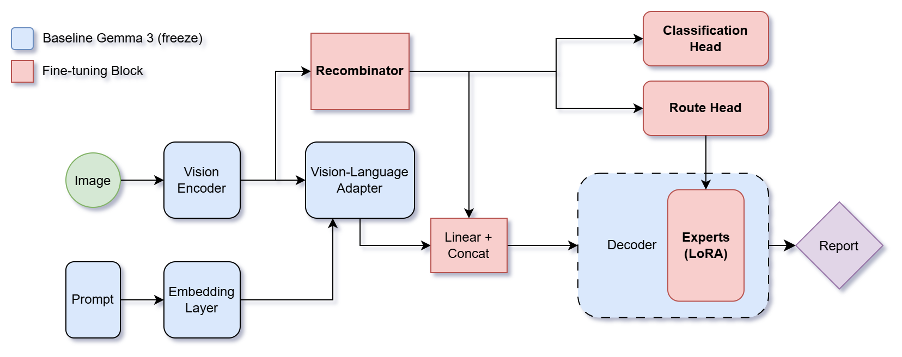

# §2.3 — Recombinator và đánh giá lâm sàng

Thí nghiệm so sánh ba candidate trên cùng pool 3.000 mẫu test: baseline Gemma 3 nguyên bản, QLoRA chỉ trên decoder, và Candidate C. C dùng QLoRA decoder như Candidate 2, thêm QDoRA rank 4 vào 1/4 layer cuối vision encoder, đóng băng projector Gemma 3, rồi chiếu nhánh Recombinator và concat token của nhánh với token adapter cùng prompt embeddings. Candidate C có classification head nhưng không có Route Head hay MoE. Loss huấn luyện là `CE + 0.1 × ASL`, không warmup hệ số ASL.

Report kèm bảng CheXbert F1 của report sinh so với report gốc và của classification head so với nhãn CheXbert từ report gốc trên cùng 10 bootstrap subset; dòng cuối là trung bình cộng của 10 subset. Blank/uncertain được mask cho metric classification head.

Scoring có thêm F1-RadGraph chính thức với `radgraph-xl`, ghi ba mức entity, partial entity-relation và complete entity-relation theo từng mẫu; các điểm được bootstrap cùng 10 subset. Primary metric vẫn là CheXbert F1.

## Kiến trúc abstract tổng quát



Sơ đồ thể hiện kiến trúc đầy đủ với Classification Head, Route Head và Experts (LoRA). Trong §2.3, Candidate C chỉ dùng Classification Head; Route Head và Experts không được bật. Fusion của Candidate C chiếu token/feature Recombinator rồi concat với token ảnh adapter và prompt embeddings.

Đầu phân loại nhận `(batch, 256, 1152)` từ Recombinator. Một query học được dùng multi-head attention (8 heads) để gộp 256 token thành một vector; một lớp tuyến tính chiếu vector này thẳng thành logits `(batch, 14, 2)`. Không còn bốn tầng pooling hay MLP ẩn trong ClsHead.

Local Extractor rút chuỗi 4.096 patch còn 256 token. Global Extractor dùng `Q=RMSNorm(local)`, `K/V=RMSNorm(vision gốc)` và trả `local + MHA(Q,K,V)`. FFN giữ chiều vision 1.152: `x + Linear(GELU(Linear(RMSNorm(x))))`, với MLP mở rộng `1.152→4×1.152→1.152`. Đầu ra này cấp cho attention pooling của ClsHead. Nhánh decoder chiếu token `256→128→64`, chiếu feature `1.152→2.560`, rồi concat với adapter ảnh và prompt embeddings.

## Quick start

Các lệnh dưới đây chạy trong Bash (Linux, WSL hoặc container) từ thư mục gốc repo.

```bash
# 1) Cài môi trường một lần
bash scripts/setup.sh

# 2) Cấp quyền tải Gemma 3 gated model và dataset
export HF_TOKEN="<your Hugging Face token>"

# 3) Thử đường train nhỏ trước, không chạy infer/metrics
bash scripts/run_recomb.sh --exp 2.3 --dry-run --stages data,train --no-wandb --no-push

# 4) Chạy toàn bộ thí nghiệm: train, infer, score, stats, report
bash scripts/run_recomb.sh --exp 2.3 --no-wandb --no-push
```

Trước lệnh đầy đủ, cài dependencies trong `requirements.txt`, gồm `f1chexbert`. Chạy lại cùng lệnh để tiếp tục từ artifacts đã có. Các lệnh hữu ích khác:

```bash
# Chỉ tái tạo thống kê và REPORT.md từ các điểm đã lưu
bash scripts/run_recomb.sh --exp 2.3 --stages stats,report --no-wandb --no-push

# Chấm lại các prediction hiện có, rồi cập nhật thống kê và report
bash scripts/run_recomb.sh --exp 2.3 --stages score,stats,report --rescore --no-wandb --no-push

# Huấn luyện lại các candidate, rồi chạy các stage còn lại
bash scripts/run_recomb.sh --exp 2.3 --retrain --no-wandb --no-push

# Retrain/infer riêng Candidate C, sau đó đánh giá đủ ba candidate và push ở nền
bash scripts/retrain_candidate_c_and_push.sh --detach
```

Đổi cấu hình qua `--set`, ví dụ `--set train.n_epochs=2`. Các candidate có thể chọn bằng `--arms baseline_infer,lora_only,lora_recomb`; để có so sánh hoàn chỉnh cần chạy đủ cả ba.

## Thiết lập hiện hành

- **Nhãn phụ trợ:** CheXbert gán nhãn trực tiếp từ report gốc cho train/val. ASL dùng hai lớp `neg` và `pos`; uncertain và blank/unmentioned được mask.
- **ASL:** dùng các giá trị mặc định của `AsymmetricLoss`: `gamma_neg=2`, `gamma_pos=0`, `clip=0.05`, `eps=1e-8`.
- **Optimizer:** AdamW, `weight_decay=0.03`, `betas=(0.9, 0.95)`.
- **Batch:** thử microbatch `16, 12, 10, 8, 6, 4, 2, 1` khi gặp OOM; effective batch giữ đúng 32 bằng microbatch cuối nhỏ hơn khi cần. Candidate đầu chọn batch và candidate còn lại dùng cùng giá trị.
- **Metric chính:** F1CheXbert micro trên 14 nhãn, tính riêng trong từng bootstrap subset 3.000 lượt lấy mẫu rồi lấy trung bình 10 F1. BLEU, ROUGE và BERTScore được giữ làm metric phụ.
- **Đánh giá:** pool 3.000 ảnh được lấy theo seed từ test split, không chạy phần test còn lại. Tạo 10 bootstrap subset khác nhau bằng 10 seed riêng (`42`–`51`); mỗi subset gồm 3.000 lượt lấy mẫu có hoàn lại từ pool này. Cùng mười tập chỉ số được dùng cho cả ba candidate và mọi metric. Thống kê và report lấy trung bình qua 10 subset.

Cấu hình chạy chính nằm ở [`configs/recombiner.yaml`](configs/recombiner.yaml); entry point là `python -m src.run_recomb --exp 2.3` hoặc `bash scripts/run_recomb.sh --exp 2.3`.

## CheXbert

Metric gọi CheXbert qua thư viện [`f1chexbert`](https://pypi.org/project/f1chexbert/) để gán nhãn cả report gốc lẫn report sinh. Khi train Candidate C, nhãn ASL cũng được tạo trực tiếp từ report target bằng CheXbert, uncertain và blank/unmentioned được mask. Không cần checkout repo mã nguồn hay đặt checkpoint thủ công; lần đầu khởi tạo thư viện tải checkpoint CheXbert và tokenizer/model BERT vào cache môi trường.

## Giới hạn thống kê

Các ước lượng bootstrap dùng trung bình của 10 subset với seed riêng `42`–`51`, mỗi subset có 3.000 lượt lấy mẫu có hoàn lại. Ma trận chỉ số được chia sẻ giữa ba candidate và mọi metric để bảo toàn so sánh ghép cặp. Report ghi số subset và kích thước từng subset.
